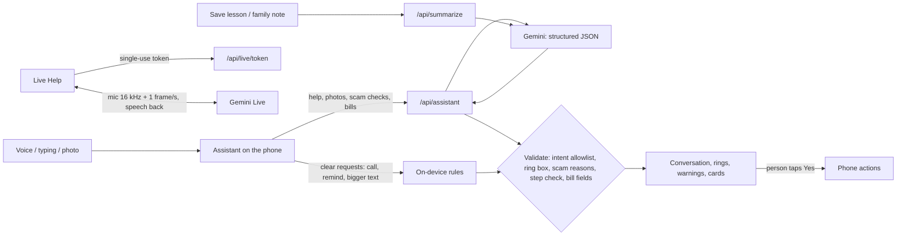

<div align="center">


# Companion

**A patient tech helper for older adults.**
Talk to it, show it a photo, or point your camera at the problem. It explains what's going on, shows you exactly where to tap, and teaches you one step at a time until you can do it yourself.

### ▶ Try it on your phone: **https://uprepcompanion.vercel.app**

Works in iPhone Safari and Android Chrome with no install. "Add to Home Screen" makes it an app.

[](video/companion-launch.mp4)

**▶ [Watch the 60-second launch film](video/companion-launch.mp4)** · *Growing technology is not a reason to leave others behind.*

[](https://github.com/Apocalypse10110/Companion/actions/workflows/ci.yml) · [Live status](https://uprepcompanion.vercel.app/status)

Built for **Ice Hacks 2026** · Next.js 16 · Google Gemini + Gemini Live · 545 automated tests + real-browser checks

</div>

> **"Siri answers your question. Companion stays until you can do it yourself."**

| Home | Show me | Spots scams | Help that fades |
| :---: | :---: | :---: | :---: |
|  |  |  |  |
| Three ways to get help: **Ask**, **Show me**, **Live Help**. | Photograph a pop-up, letter or router. It explains, then rings the button to press. | A suspicious text? **STOP**, why it looks wrong, and how to check safely. | The second time, it lets you try first. Help is always one tap away. |

Technology has become essential, but not everyone has been able to keep up. A pop-up you don't understand, Wi-Fi that won't connect, a text that might be a scam: the usual answer is "ask your grandchild". Companion stays with you through the problem, checks each step, and steps back as you learn. The goal is independence, not dependence on an AI.

## What it does

| | |
| --- | --- |
| **Ask** | Talk or type. One plain step at a time, says what things look like ("the grey gear"), waits for you. Answers in the language you speak. |
| **Show me + Tap here** | Take a photo or pick a screenshot. Companion says what it is, then draws a thick, high-contrast ring on the exact button to press. Coordinates from the AI are checked on the server and again on the phone; if the AI isn't sure, there's no ring and it describes the place in words instead. |
| **Live Help** | Point the camera and talk naturally. Gemini Live sees about one picture a second and answers out loud; you can interrupt it any time. Captions on screen. If Live Help can't start: *"Live Help isn't available right now. Let's use Show Me instead."*, keeping what you said. |
| **Check my step** | After each instruction: **I've done it**, **Show me again**, **That didn't work**, or **Check my screen with a photo**. Companion only says a step worked when you say so or the photo shows it. |
| **Help that fades** | Each task has five levels: full guidance, shorter steps, "Do you remember where to find that?", try the whole thing and check, then **Learned**. Asking for help never counts against you. |
| **My Skills** | Everything you've learned: Learning, Practising, Nearly there, Learned, with "Done on your own 3 times" and when you last did it. No scores. |
| **Fridge Card** | "Save this lesson for next time" turns a finished task into a large, black-and-white printable card with numbered steps and "if it doesn't work" tips. |
| **Safety** | Paste or photograph a message. **STOP. This message may be a scam.** / Be careful / No warning signs found / Can't tell, with the reasons and how to check independently. Never "definitely safe". |
| **Call Shield** | Play a suspicious call on speaker on *another* phone; Companion listens with its own microphone and flags requests for codes, PINs, gift cards, secrecy or "safe accounts" as they're said. It can't hear calls on its own phone (no web app can) and never listens in secret. |
| **Scam Bait** | "Doris", a muddled grandma, writes time-wasting replies to real scam texts; you send them yourself. A practice round uses a clearly labelled pretend scammer. Inspired by O2's Daisy. |
| **Point at a bill** | Photograph a bill or letter: who it's from, amount, due date and reference, with anything hard to read flagged. "Remind me before it's due" only after you confirm. It never pays anything. |
| **Help Card** | After a scam warning or a hard task: "Share this with my family". A short note in your voice goes to someone in People (you check it, then press Send in Messages) or through the share sheet, after a confirmation. |
| **Does things, always asking first** | Calls, texts, FaceTime, reminders, weather, email and calendar (once connected), bigger text. It never says it did something it didn't. |

**Scam detection, measured:** caught **10 of 10** scam messages it had never seen, with **0 false alarms** on 10 genuine ones (and 30/30, 0 false alarms on our 60-message set). See [Scam scorecard](#scam-scorecard-measured-nov-13-gemini-35-flash).

## Try these

1. **Show me** a "Storage Almost Full" pop-up. A ring appears around *Manage Storage*. Tap **I've done it**, or **Check my screen with a photo**.
2. **Live Help**: point at your router and say "I don't know which button to press". Interrupt it with another question.
3. **Safety**: paste "Royal Mail: your parcel is on hold, pay £1.45 at royalmail-fee.com".
4. Ask "How do I connect to Wi-Fi?" and finish it. Ask again later: it asks if you remember first. See **My Skills**, then **Print my lesson card**.
5. **Read a bill or letter** from the home screen, then **Remind me before it's due**.
6. **Safety → Listen to a call on another phone**, and play a "this is your bank, read me the code" call.
7. "Call my daughter" (add her in Settings → People first), "Remind me to take my pills at 8", "Make the text bigger".

## How the AI works



- **The AI is untrusted.** Every reply field is checked on the server and again on the phone: the action allowlist, the ring's four coordinates (0–1000, right way round, not a speck, not the whole photo, dropped when the model says it's unsure), scam reasons (no links or long numbers), step checks (only for a photo sent to be checked), bill fields (an amount must look like money, a date must be a real date).
- **Help that fades** is stored on the phone (`src/ai/skills.ts`) and sent as "connect to wifi (level 3, done 2 times)", so the prompt knows how much to say.
- **Keys stay on the server.** There is no `NEXT_PUBLIC_` key. Live Help gets a **single-use token** that expires in 15 minutes and is locked to one Live model and Companion's instructions. Every AI route checks the origin, rate-limits callers and caps body size.
- **Reliability.** Gemini models are tried in order when one is busy; every call has a timeout and bounded fallback. Clear requests work with no AI and no internet. Live Help falls back to Show Me; lesson cards fall back to the steps from the conversation.
- **Photos** are shrunk on the phone (about 1280 px JPEG, which removes location data), sent once, and never stored.

More: [docs/AI_ARCHITECTURE.md](docs/AI_ARCHITECTURE.md) · [docs/PRIVACY.md](docs/PRIVACY.md).

## Scam scorecard (measured, Nov 13, `gemini-3.5-flash`)

We sent real-world-style messages to Companion's live assistant and counted its verdicts (`npm run eval:scams`).

| Run | Scams caught | False alarms on genuine messages |
| --- | --- | --- |
| First run, 60 messages | **30 of 30** | 9 of 30: it distrusted real bank and delivery texts |
| After fixing the rules, same 60 | **30 of 30** | **0 of 30** |
| **New, unseen messages** (honest check, never used for tuning) | **10 of 10** | **0 of 10** |

**What the fix changed:** Companion judges what a message *asks you to do* (pay, click to verify, share a code, keep it secret) rather than who it claims to be from.

**Limits:** the messages are written from common UK and US scam types, with fictional numbers and links, not collected from real phones. These numbers are from before the Nov 13 prompt changes (scam reasons, "unsure" verdict); re-run `npm run eval:scams` with a key to re-measure. Data and results: [`evals/`](evals/).

## What works on a phone (and what can't)

| Feature | iPhone (Safari) | Android (Chrome) |
| --- | --- | --- |
| Talk to it / read replies aloud | Yes | Yes |
| Show me: live camera, or a photo or screenshot | Yes | Yes, and you can share a screenshot to the installed app |
| Live Help (camera + voice) | Yes, over https | Yes, over https |
| Call Shield | Yes (listens to *another* device) | Yes (listens to *another* device) |
| Print a lesson card | Share → Print | Menu → Share → Print |
| "Call my daughter" / "Text Anna I'm late" | Opens the dialer or Messages, filled in; you press Call or Send | Same |
| Reminders | On screen and spoken while Companion is open; notifications once added to the Home Screen | Same, with notifications while open or recently in the background |
| Email, calendar, music (after connecting in Settings) | Gmail, Google Calendar, Outlook, Spotify | Same |
| Open Camera / Photos / Settings apps | No web app can; it explains how to find them | Same |
| Read SMS, call history, or hear phone calls on the same phone | Phones never allow it | Same |

## Run it yourself

```bash
npm install
cp .env.example .env.local      # then set GEMINI_API_KEY (https://aistudio.google.com/apikey)
npm run dev                     # http://localhost:3000
```

With no key, the app still runs. Clear requests are handled on the device, questions get an honest "my online helper isn't connected", and Live Help offers Show Me instead.

### Deploying (Vercel)

1. Import the repo into Vercel (framework: Next.js, no other settings needed).
2. **Settings → Environment Variables:** add `GEMINI_API_KEY` for Production (and Preview if wanted). Never use a `NEXT_PUBLIC_` name for it. Optionally set `GEMINI_LIVE_MODEL` (comma-separated Live models, tried in order) and `AI_MODEL`.
3. Deploy. Check `https://<your-site>/api/assistant` shows `{"configured":true,"provider":"gemini"}` and `/status` is green.
4. Open **Live Help** on a phone. If it says it isn't available, check the current Live model names in Google AI Studio and set `GEMINI_LIVE_MODEL`.
5. Run the end-to-end check against it: `BASE_URL=https://<your-site> npm run test:e2e`.

All variables are listed, with placeholders only, in [`.env.example`](.env.example).

### Gemini quota (do this before judging)

1. In https://aistudio.google.com open the key's Google Cloud project and **Set up billing** (paid tier, much higher limits).
2. In Google Cloud Console, **Billing → Budgets & alerts → Create budget** (for example $20 with alerts at 50%, 90% and 100%).
3. If a limit is still hit, people see "I can't reach my online helper right now, please try again in a minute". Calls, reminders and settings keep working.

On the paid tier, Google doesn't use prompts to improve its products; on the free tier it may. See [docs/PRIVACY.md](docs/PRIVACY.md).

## Checks

```bash
npm test               # 545 unit, behaviour, AI, server-route, voice and accessibility (axe) tests
npm run typecheck && npm run lint
npm run build && npm start      # then, in another terminal:
npm run test:ui        # real browser: every screen at largest text + dark high contrast, nothing overflows
npm run test:e2e       # real browser + real Gemini: conversation, voice, Show Me, calls, reminders, offline
npm run eval:scams     # scam scorecard against the live assistant
```

Every push runs lint, typecheck, tests and a production build on GitHub Actions. `GET /api/health` (shown at `/status`) reports whether the app, the AI and each account service are working.

**Not verified yet:** real Gemini answers for the new reply fields (scam reasons, step checks, bill reading, ring confidence) and Live Help against the real Gemini Live API were not run in the build environment (no key there), and the newest screens haven't been tried on a real phone. See [docs/DEVELOPMENT_STATUS.md](docs/DEVELOPMENT_STATUS.md).

## Project layout

| Area | Where |
| --- | --- |
| Screens and design system | `src/app`, `src/ui` (`screens`, `conversation`, `safety`, `skills`, `lessons`, `live`, `components`) |
| Assistant, rules, validators, help that fades | `src/ai` (`assistant.ts`, `target.ts`, `skills.ts`, `callShield.ts`) |
| Server AI routes | `src/ai/server` (`handler.ts`, `gemini.ts`, `live.ts`, `summarize.ts`, `guard.ts`) |
| Live Help client | `src/live`, `public/live-mic-worklet.js` |
| Voice | `src/voice` |
| Phone actions, reminders, people, camera | `src/actions`, `src/people`, `src/phone`, `src/permissions` |
| Lesson cards | `src/lessons` |
| Shared interfaces | `src/contracts`, wired in `src/integration/index.ts` |
| Launch film (HTML timeline → MP4, `npm run video`) | `video/launch.html`, `video/render.mjs` |

- [docs/AI_ARCHITECTURE.md](docs/AI_ARCHITECTURE.md): pipeline, validation, fading levels, Live Help, Call Shield
- [docs/PRIVACY.md](docs/PRIVACY.md): what leaves the phone
- [docs/DEVELOPMENT_STATUS.md](docs/DEVELOPMENT_STATUS.md): what's done, what's verified, what's next
- [docs/ACTION_SCHEMA.md](docs/ACTION_SCHEMA.md) · [docs/CONTRACTS.md](docs/CONTRACTS.md) · [docs/ARCHITECTURE.md](docs/ARCHITECTURE.md) · [docs/UI.md](docs/UI.md) · [docs/ACCOUNTS.md](docs/ACCOUNTS.md) · [docs/DEVICE.md](docs/DEVICE.md)
- [TEAM.md](TEAM.md): who owns what
