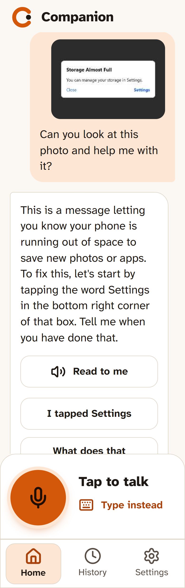
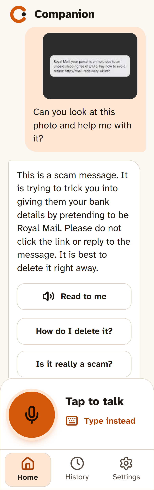
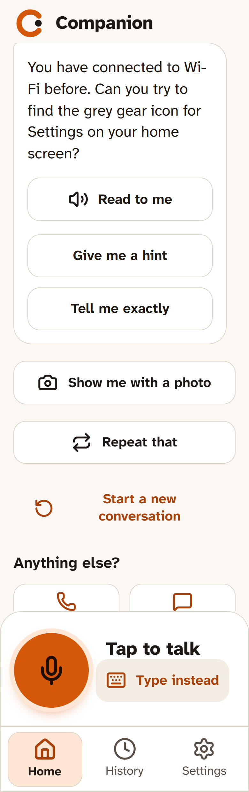
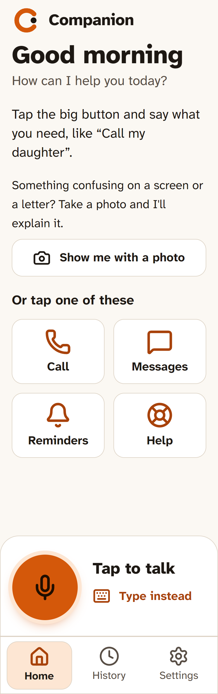
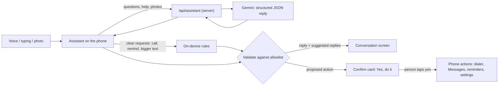

<div align="center">


# Companion

**A patient tech helper for older adults.**
Talk to it, type to it, or *show* it a photo. It explains what's going on, then teaches you one step at a time until you can do it yourself.

### ▶ Try it on your phone: **https://uprepcompanion.vercel.app**

Works in iPhone Safari and Android Chrome with no install. "Add to Home Screen" makes it an app.

[](https://github.com/Apocalypse10110/Companion/actions/workflows/ci.yml) · [Live status](https://uprepcompanion.vercel.app/status)

Built for **Ice Hacks 2026** · Next.js 16 · Google Gemini · ~390 automated tests + real-browser end-to-end checks

</div>

| Show me a photo | Spots scams | Help that fades | Big, calm, readable |
| :---: | :---: | :---: | :---: |
|  |  |  |  |
| Photograph a confusing pop-up, letter or router. It says what it is in plain words, then gives the first step. | A suspicious text or pop-up? It says plainly when something is a scam and what not to tap. | The second time, it asks you to try first, with **Give me a hint** or **Tell me exactly**. | Large text, high contrast, read aloud. It always asks before calling or texting anyone. |

> **"Siri answers your question. Companion stays until you can do it yourself."**

**Scam detection, measured:** caught **10 of 10** scam messages it had never seen, with **0 false alarms** on 10 genuine ones (and 30/30, 0 false alarms on our 60-message set). See [Scam scorecard](#scam-scorecard-measured-nov-13-gemini-35-flash).

Technology can be confusing, especially when you're not used to it. A pop-up you don't understand, Wi-Fi that won't connect, a text that might be a scam. The usual answer is "ask your grandchild" or wade through tutorials full of words like *toggle* and *app drawer*.

Companion is an AI helper you can **talk to, type to, or just show**. Point the camera at whatever is confusing and it says what it is in plain words, then walks you through fixing it **one step at a time**. It remembers what you've learned, so next time it lets you try first and only gives a hint if you need one. The goal isn't to do things for you forever. It's to help you stay independent.

Technology should bring people together, not leave anyone behind.

## Try these

1. **"I can't connect to the Wi-Fi."** It asks one question at a time and gives one step at a time. Say "done" or tap a suggestion to go on.
2. **Tap "Show me with a photo"** and photograph a pop-up, a letter or your router (or pick a screenshot). It explains what it sees and gives the first step.
3. **Show it a suspicious text** ("your parcel is on hold, pay £1.45"). It tells you plainly if it looks like a scam and not to tap anything.
4. **"Call my daughter"** (add her first in Settings → People). It asks first, then opens your phone app with her number. You press Call.
5. **"Make the text bigger"** or **"Remind me to take my pills at 8."**
6. **"Read my email"** or **"What's on tomorrow?"**: turn on **Settings → Connected accounts → Try a sample inbox and calendar** to try it without signing in.
7. **"Will it rain tomorrow?"** or **"FaceTime my daughter"** (FaceTime on iPhone).
8. Ask the same how-to question again later. Because you've done it before, it asks you to try first ("Give me a hint" / "Tell me exactly"). See **Settings → Things you can do**.

## What makes it different from Siri or Google Assistant

| | Typical voice assistant | Companion |
| --- | --- | --- |
| A problem you can't describe | "I didn't get that" | **Show me**: take a photo, it tells you what it is |
| How-to questions | A web result or a list of 8 steps | One step, waits, checks, then the next. Says what buttons look like |
| The first time you ask | An answer, then it's gone | **A lesson:** "Teaching you: Connect to Wi-Fi", one step at a time with the why, or "Let me try it myself" |
| The second time you ask | The same answer | **Help that fades:** "You've done this before: try it yourself", with hints only if you ask. Finished tasks go into **Things you can do** |
| Scams | Answers whatever you ask | Warns about scam texts, pop-ups and "call this number" tricks |
| Doing things | Acts straight away | Always asks first. Never says it called or sent something it didn't |
| Words | Its own jargon | Plain words, large text, high contrast, read aloud slowly |

## How the AI works



- **The AI is treated as untrusted.** Gemini returns JSON (`intent`, `reply`, `suggestions`, `skill`, `taskDone`). Every intent goes through the same allowlist validator as the on-device rules. The AI can suggest an action, but only our code builds it, and only the person's tap runs it.
- **Teaching that fades.** The AI names the task it's teaching and marks it done when you succeed. Finished tasks are kept on the phone (`src/ai/skills.ts`) and sent with later questions, and the prompt changes from "give the step" to "let them try first".
- **Photos.** They're shrunk on the phone (about 1280 px JPEG, which also removes location data and converts iPhone HEIC), sent once, and never stored.
- **Reliability.** Gemini models are tried in order (`gemini-3.5-flash`, then `gemini-3.1-flash-lite`, then `gemini-2.5-flash`) when one is overloaded or out of quota. Replies take about 2 seconds. Clear requests work with no AI and no internet. Errors become plain messages, never a crash.
- **The key stays on the server.** There is no `NEXT_PUBLIC_` key, the server checks the request origin, rate-limits each caller and caps body size, and `GET /api/assistant` reports status without the key.

More: [docs/AI_ARCHITECTURE.md](docs/AI_ARCHITECTURE.md) · [docs/PRIVACY.md](docs/PRIVACY.md).

## Scam scorecard (measured, Nov 13, `gemini-3.5-flash`)

We sent real-world-style messages to Companion's live assistant and counted its verdicts (`npm run eval:scams`).

| Run | Scams caught | False alarms on genuine messages |
| --- | --- | --- |
| First run, 60 messages | **30 of 30** | 9 of 30: it distrusted real bank and delivery texts |
| After fixing the rules, same 60 | **30 of 30** | **0 of 30** |
| **New, unseen messages** (honest check, never used for tuning) | **10 of 10** | **0 of 10** |

**What the fix changed:** Companion now judges what a message *asks you to do* (pay, click to verify, share a code, keep it secret) rather than who it claims to be from.

**Limits:** the messages are written from common UK and US scam types, with fictional numbers and links, not collected from real phones. A real-message set would be the next step. Data and results: [`evals/`](evals/).

## What works on a phone (and what can't)

| Feature | iPhone (Safari) | Android (Chrome) |
| --- | --- | --- |
| Talk to it / read replies aloud | Yes | Yes |
| Show me: live camera (back or front), take, retake | Yes | Yes |
| Show me: photo or screenshot from the phone | Yes | Yes, and you can share a screenshot to the installed app |
| "Call my daughter" | Opens the dialer with the number; you tap Call. Coming back reopens the conversation | Same |
| "Text Anna I'm late" | Opens Messages with the text ready; you tap Send | Same |
| Who "my daughter" is | Settings → People: type it, or import a contact card from Contacts | Settings → People, or pick from your contacts |
| Reminders | By voice or in Settings (add, edit, done, repeat). On screen and spoken while Companion is open; notifications once added to the Home Screen | Same, with notifications while open or recently in the background |
| Email, calendar, music (after connecting in Settings) | "Read my email", "what's on my calendar tomorrow?", "play some Frank Sinatra" (Gmail, Google Calendar, Outlook, Spotify) | Same |
| Device permissions | Settings → Device permissions: status, why, allow, how to turn on | Same |
| Maps, email, web search | Yes | Yes |
| Open Camera / Photos / Settings apps | No web app can; it explains how to find them | Same |
| Read SMS or call history | Phones never allow it; it offers to open Messages | Same |

## Run it yourself

```bash
npm install
cp .env.example .env.local      # then set GEMINI_API_KEY (https://aistudio.google.com/apikey)
npm run dev                     # http://localhost:3000
```

With no key, the app still runs. Clear requests are handled on the device, and questions get an honest "my online helper isn't connected".

### Deploying (Vercel)

1. Import the repo into Vercel (framework: Next.js, no other settings needed).
2. **Settings → Environment Variables:** add `GEMINI_API_KEY` for Production (and Preview if wanted). Never use a `NEXT_PUBLIC_` name for it.
3. Deploy. Check `https://<your-site>/api/assistant` shows `{"configured":true,"provider":"gemini"}`.
4. Run the end-to-end check against it: `BASE_URL=https://<your-site> npm run test:e2e`.

### Gemini quota (do this before judging)

The free tier allows only a limited number of requests per model per day. We used up `gemini-3.5-flash`'s daily allowance during testing, and the fallback to other models is what kept the app working. For the demo and judging:

1. Go to https://aistudio.google.com, then **Get API key**, then open the key's Google Cloud project and **Set up billing** (moves the key to the paid tier, with much higher limits).
2. In Google Cloud Console, go to **Billing**, then **Budgets & alerts**, then **Create budget** (for example $20 with alerts at 50%, 90% and 100%) so a traffic spike can't run up a bill. Photos and short replies cost a fraction of a cent each.
3. Optionally set `AI_MODEL` on Vercel to choose the order, for example `gemini-3.1-flash-lite,gemini-3.5-flash`.
4. If a limit is still hit, people see "I can't reach my online helper right now, please try again in a minute". The app keeps working for calls, reminders and settings.

On the paid tier, Google doesn't use prompts to improve its products; on the free tier it may. See [docs/PRIVACY.md](docs/PRIVACY.md).

## Checks

```bash
npm test               # ~390 unit, behaviour, AI, voice, phone-action and accessibility (axe) tests
npm run typecheck && npm run lint
npm run build && npm start      # then, in another terminal:
npm run test:ui        # real browser: every screen at largest text + high contrast, nothing overflows
npm run test:e2e       # real browser + real Gemini: conversation, voice, Show Me, calls, reminders, offline
```

Every push runs lint, typecheck, tests and a production build on GitHub Actions (`.github/workflows/ci.yml`).
`GET /api/health` (shown at `/status`) reports whether the app, the AI and each account service are working.
It returns 200 or 503, so an uptime monitor such as UptimeRobot can watch it.

`test:e2e` drives the real UI: typed help with follow-up context, voice in with the reply spoken, a photo of a "Storage Almost Full" pop-up, a photo of a scam text, calling an unknown and a saved person, "make the text bigger", a reminder with the notification request, and going offline.

## Project layout and team

| Area | Owner | Where |
| --- | --- | --- |
| Mobile UI, accessibility, onboarding, settings, conversation screen | Developer A | `src/app`, `src/ui` |
| Assistant (AI) and voice in/out | Developer B | `src/ai`, `src/voice` |
| Camera, device permissions, contacts, call return, reminders management, quick access | Developer D | `src/phone`, `src/permissions/catalog.ts`, `src/people/vcard.ts`, `src/ui/conversation/CameraSheet.tsx` |
| Integration, Gemini, Show Me, phone actions, permissions | Developer C | `src/ai/server`, `src/actions`, `src/permissions`, `src/people`, `src/phone`, `src/integration` |

Everything is wired together in one place: [`src/integration/index.ts`](src/integration/index.ts). The shared interfaces are in `src/contracts`.

- [docs/AI_ARCHITECTURE.md](docs/AI_ARCHITECTURE.md): voice, intents, context, AI providers, photos, key handling
- [docs/ACTION_SCHEMA.md](docs/ACTION_SCHEMA.md): what the assistant asks the phone to do
- [docs/CONTRACTS.md](docs/CONTRACTS.md): the interfaces between the parts
- [docs/ARCHITECTURE.md](docs/ARCHITECTURE.md): module boundaries
- [docs/UI.md](docs/UI.md): design system and accessibility rules
- [docs/PRIVACY.md](docs/PRIVACY.md): what leaves the phone
- [docs/ACCOUNTS.md](docs/ACCOUNTS.md): connecting Gmail, Google Calendar, Outlook and Spotify (setup steps and limits)
- [docs/DEVICE.md](docs/DEVICE.md): camera, contacts, permissions, calls and coming back, reminders, quick access, native-app plan
- [docs/DEVELOPMENT_STATUS.md](docs/DEVELOPMENT_STATUS.md): what's done and what's next
- [TEAM.md](TEAM.md): who owns what
